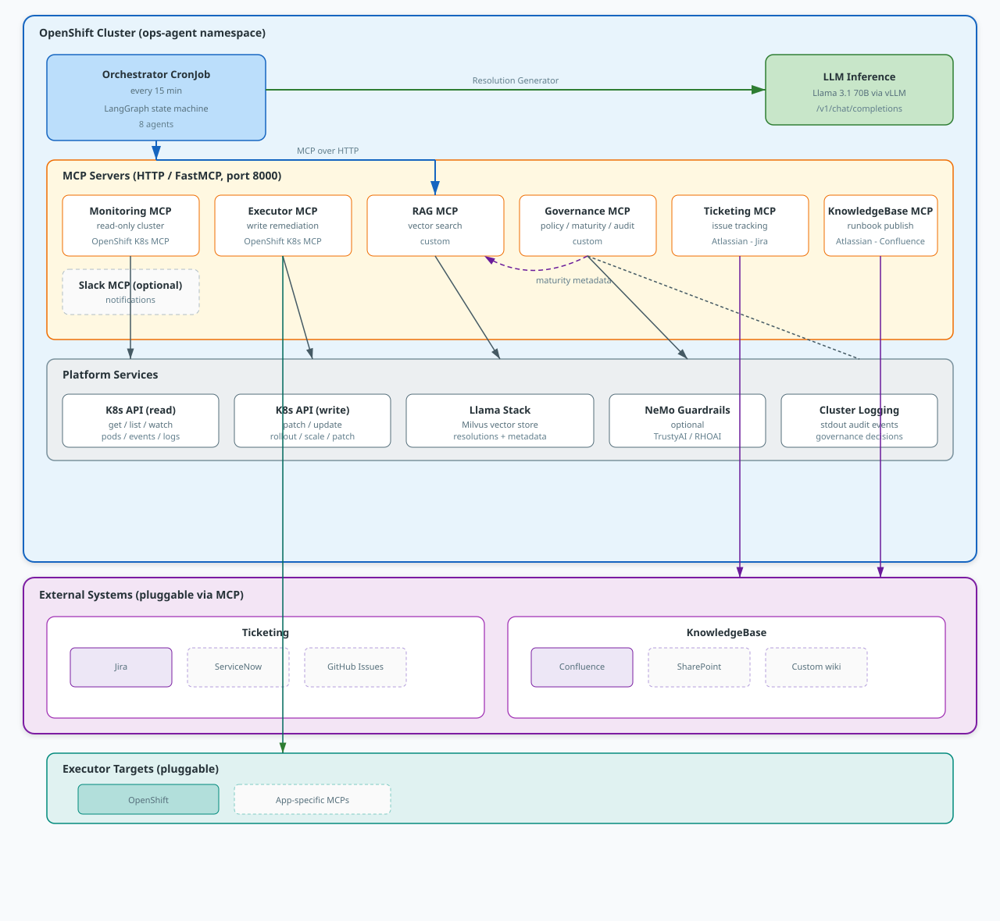
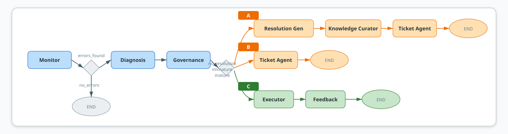

# Architecture Overview

Self-Healing OpenShift Operations Agent — an AI-driven system that monitors OpenShift clusters, diagnoses application failures, and autonomously remediates known issues once they earn sufficient trust through repeated successful application.

## System Components



The orchestrator runs as an OpenShift CronJob every 15 minutes and coordinates eight LangGraph agents. It has no direct Kubernetes RBAC — all cluster, knowledge, governance, and ticketing interactions go through MCP servers over HTTP (FastMCP, port 8000). The Resolution Generator agent calls the LLM directly via `/v1/chat/completions`.

The Governance MCP reads and writes maturity scores as document metadata in the RAG MCP (Milvus via Llama Stack). Monitoring and Executor MCPs connect to separate read-only and write-enabled Kubernetes API endpoints. Ticketing and KnowledgeBase MCPs route to pluggable external systems (Jira and Confluence by default). Executor targets are also pluggable (OpenShift by default).

### Orchestrator

LangGraph state machine that runs as an OpenShift CronJob every 15 minutes. The workflow graph and agent personas are defined declaratively in YAML configuration (`orchestrator/config/workflow.yaml` and `personas.yaml`). The orchestrator has no direct Kubernetes RBAC — it interacts with the cluster exclusively through MCP servers.

Entry point: `python -m orchestrator.main`

### MCP Servers

The orchestrator connects to MCP servers over HTTP (port 8000). Three of the five integration points are pluggable — any MCP-compatible server can be swapped in.

| Server | Role | Purpose | Current Default |
|--------|------|---------|-----------------|
| Monitoring MCP | Read-only cluster access | `list_pods`, `list_events`, `get_pod_logs` | OpenShift Kubernetes MCP (upstream) |
| Executor MCP(s) | Write access for remediation | `rollout_restart`, `scale`, `patch_resource` | OpenShift Kubernetes MCP (upstream) |
| Ticketing MCP | Issue tracking for human review | Create tickets for new/immature resolutions | Atlassian MCP → **Jira** (upstream) |
| KnowledgeBase MCP | Runbook/resolution publishing | Publish resolutions as searchable documents | Atlassian MCP → **Confluence** (upstream) |
| RAG MCP | Vector search over resolutions | `query_kb`, `ingest_document`, `get_document`, `update_metadata` | Custom (`mcp-servers/rag/`) |
| Governance MCP | Policy enforcement & trust | Maturity scoring, deny-list, audit logging | Custom (`mcp-servers/governance/`) |

#### Pluggable Integration Points

**KnowledgeBase** — The Knowledge Curator agent publishes resolutions to a KnowledgeBase system for human consumption. The framework connects to any KnowledgeBase via its MCP server. Current implementation uses Confluence via the Atlassian MCP; alternatives include SharePoint, Notion, or any custom wiki with an MCP interface.

**Ticketing** — The Ticket Agent creates issues for human review when resolutions are new or not yet trusted. The framework connects to any ticketing system via its MCP server. Current implementation uses Jira via the Atlassian MCP; alternatives include ServiceNow, GitHub Issues, or PagerDuty with an MCP interface.

**Executor** — The Executor agent applies fix steps through one or more execution MCP servers. The framework is not limited to a single executor — multiple MCP servers can be connected to remediate across different platforms. Current implementation uses the OpenShift Kubernetes MCP; additional executors could include database or application-specific MCP servers.

The governance server has a cross-server dependency: it calls the RAG MCP server via `fastmcp.Client` to read and write maturity scores stored as document metadata.

### Infrastructure Layer

Two complementary deployment mechanisms:

- **Kustomize overlays** (`cluster-setup/`) — Platform-scoped resources requiring cluster-admin: RHOAI operator subscription, DataScienceCluster CR, Llama Stack distribution, NeMo Guardrails, namespace creation. Applied in numbered order (00 through 04).
- **Helm chart** (`helm/ops-agent/`) — Application-scoped resources deployable by a namespace admin: Deployments, Services, ServiceAccounts, Roles, RoleBindings, ConfigMaps, and the orchestrator CronJob.

## Agent Workflow



Eight specialized agent roles process cluster state through a directed graph with two conditional routing points:

1. **Monitor** — routes to `END` when no errors are found, otherwise continues to Diagnosis.
2. **Governance** — routes based on resolution maturity:
   - `no_resolution` → Path A
   - `immature` (maturity &lt; 80) → Path B
   - `mature` (maturity &gt;= 80) → Path C

### Agent Roles

| Agent | Responsibility | Integration Points |
|-------|---------------|-------------------|
| **Monitor** | Detects unhealthy pods (CrashLoopBackOff, Error, ImagePullBackOff, OOMKilled, Pending, restart count > 3) | Monitoring MCP |
| **Diagnosis** | Searches RAG KnowledgeBase for historical resolutions matching the error pattern | RAG MCP |
| **Governance** | Evaluates whether a resolution can be auto-applied based on maturity score and policies | Governance MCP |
| **Resolution Generator** | Uses the LLM to generate a new resolution when none exists in the KB | LLM (direct call) |
| **Knowledge Curator** | Publishes new resolutions to the KnowledgeBase and indexes them into RAG with initial maturity 0 | KnowledgeBase MCP, RAG MCP |
| **Ticket Agent** | Creates a ticket for human review (used for new and immature resolutions) | Ticketing MCP |
| **Executor** | Applies fix steps to the target platform after deny-list validation | Executor MCP(s), Governance MCP |
| **Feedback** | Updates the resolution's maturity score based on the outcome (+10 success, -20 failure) | Governance MCP |

### Three Execution Paths

**Path A — New issue, no resolution in KB:**
Monitor → Diagnosis → Governance → Resolution Generator → Knowledge Curator → Ticket Agent → END
*Outcome: Resolution generated, published to KnowledgeBase, ticket created for human review.*

**Path B — Known issue, resolution not yet trusted (maturity < 80):**
Monitor → Diagnosis → Governance → Ticket Agent → END
*Outcome: Ticket created referencing the existing resolution for human approval.*

**Path C — Known issue, resolution trusted (maturity >= 80):**
Monitor → Diagnosis → Governance → Executor → Feedback → END
*Outcome: Fix applied autonomously via executor MCP(s), maturity score updated.*

## Maturity & Trust Model

Resolutions follow a graduated trust lifecycle before autonomous execution is permitted:

```
Score:  0    10    20    30    40    50    60    70    80    90   100
        ├─────┼─────┼─────┼─────┼─────┼─────┼─────┼─────┼─────┼─────┤
        │◄──────── Immature (Path B) ────────►│◄── Mature (Path C) ──►│
                                               │
                                          Threshold (80)
```

- **Starting score:** 0 (every new resolution begins untrusted)
- **Success:** +10 (requires 8 consecutive successes from zero to graduate)
- **Failure:** -20 (a single failure drops the score, requiring additional successes to recover)
- **Range:** 0–100 (clamped)
- **Graduation threshold:** 80 (configurable via `maturityThreshold` in Helm values)

Maturity scores are stored as metadata on resolution documents in the Milvus vector store — no separate database is needed.

## Safety Controls

### RBAC Separation
The orchestrator has no direct Kubernetes API access. Two separate MCP servers enforce a read/write boundary:
- **Readonly MCP:** `get`, `list`, `watch` on pods, events, pod logs, deployments, replicasets
- **Executor MCP:** Adds `patch`, `update` permissions. Used only by the Executor agent on the mature resolution path.

### Deny List
The Executor checks every fix step against a deny list before execution. Blocked operations:
- `delete_namespace`
- `scale_to_zero`
- `modify_rbac`
- `access_secret`

### KB Access Policy
The governance server enforces that agents can only access KnowledgeBases for their own application scope, unless running in `platform-scoped` mode.

### Content Safety
Optional integration with NVIDIA NeMo Guardrails for LLM content safety checks (enabled via `ENABLE_NEMO_GUARDRAILS` environment variable).

### Audit Trail
All governance decisions (maturity changes, deny-list checks, self-heal gates) are emitted as structured JSON audit events to stdout for collection by the cluster's logging stack.

## State Management

The system intentionally has no database. State is distributed across purpose-built systems:

| State | Storage | Accessed By |
|-------|---------|-------------|
| Live cluster health | Platform API via Monitoring MCP (pods, events, logs) | Monitor, Executor |
| Resolution documents | Milvus vector store via Llama Stack | Diagnosis, Knowledge Curator |
| Maturity scores | Document metadata in Milvus | Governance, Feedback |
| Tickets | Ticketing system (Jira, ServiceNow, GitHub Issues, etc.) | Ticket Agent |
| Runbooks | KnowledgeBase (Confluence, SharePoint, etc.) | Knowledge Curator |
| Per-run workflow state | `OrchestratorState` TypedDict (ephemeral) | All agents within a single run |

## Deployment Scopes

The system supports two operational scopes, selected at deploy time:

- **App-scoped** (`scope: app-scoped`, `appName: <name>`): Monitors a single named application. Each app gets its own isolated vector store collection (named `kb-{app_slug}`).
- **Platform-scoped** (`scope: platform-scoped`): Monitors all applications in the namespace with cross-application KB access.

## Technology Stack

| Layer | Technology |
|-------|-----------|
| Agent framework | LangGraph (state machine with conditional routing) |
| MCP framework | FastMCP >= 2.0 (server and client) |
| LLM | Llama 3.1 70B Instruct via OpenAI-compatible API (vLLM) |
| Vector store | Milvus (via Llama Stack Vector Stores API) |
| Language | Python 3.12+, fully async |
| Data models | Pydantic v2 |
| HTTP client | httpx (async) |
| Container base | UBI 9 Python 3.12, dependencies installed with uv |
| Orchestration | OpenShift CronJob |
| Platform | RHOAI 3.4 (Red Hat OpenShift AI) |
| Guardrails | TrustyAI / NeMo Guardrails (optional) |
| KnowledgeBase | Confluence (default); pluggable to SharePoint, Notion, or any MCP-compatible wiki |
| Ticketing | Jira (default); pluggable to ServiceNow, GitHub Issues, or any MCP-compatible tracker |
| Execution targets | OpenShift (default); extensible to additional platforms via multiple executor MCPs |
