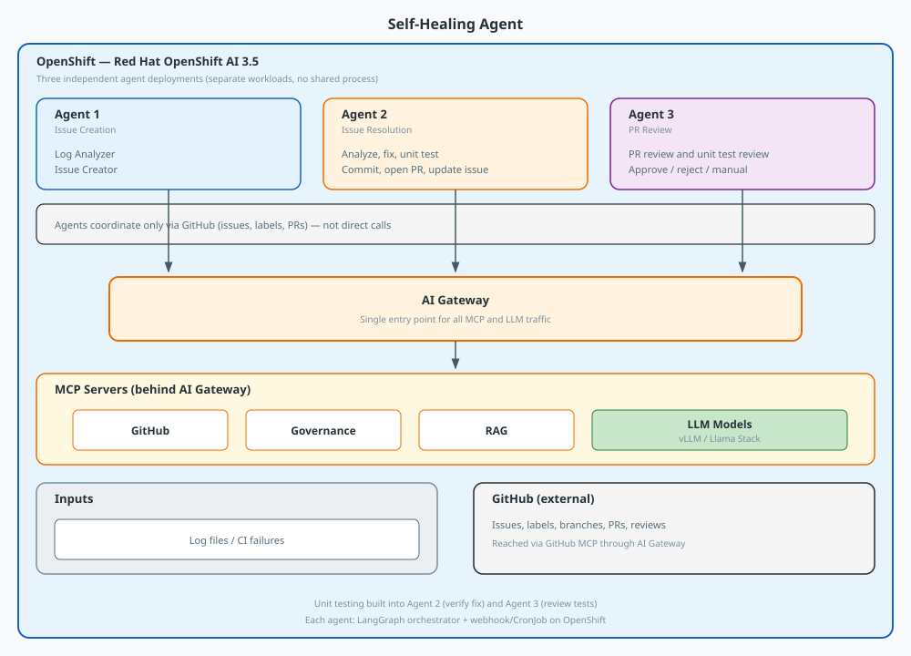
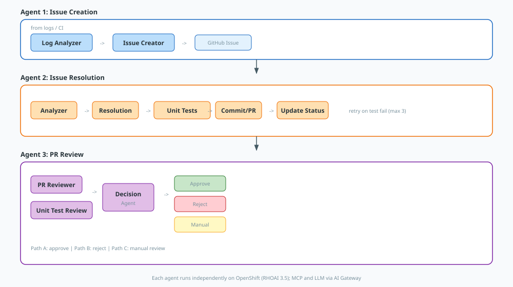

# Self-Healing Agent Architecture

**Application Self-Healing Agent** is an AI-driven pipeline with **three independent agents** — Issue Creation, Issue Resolution, and PR Review — that detect problems from **application logs**, file GitHub issues, generate fixes with unit test verification, open pull requests, and route each PR through a separate review process.

This architecture extends the same LangGraph + FastMCP patterns used by the OpenShift operations agent, but targets **source-code remediation via GitHub** instead of cluster remediation via OpenShift MCP.

All three agents run as **independent workloads on OpenShift** under **Red Hat OpenShift AI (RHOAI) 3.5**. They do not share a process, database, or orchestrator instance. Coordination happens exclusively through GitHub (issues, labels, PRs, webhooks).

## Quick Start

The Red Hat AI quick start [agentic-software-factory](https://github.com/rh-ai-quickstart/agentic-software-factory.git) can be enhanced for this use case. It already deploys an agentic software factory on OpenShift AI: agents file GitHub issues, open pull requests, review changes, repair pipelines, and triage application logs through a central AI gateway.

Extend those agents into the Application Self-Healing Agent:

| Quick start | Enhancement for this use case |
|-------------|-------------------------------|
| **Rummager** | Issue Creation: detect runtime errors in application logs and CI failures, deduplicate by error signature, and open a `needs-fix` issue |
| **Developer** | Issue Resolution: generate a source fix, run the full pytest suite, retry on failure, and open a pull request linked to the issue |
| **Review** | PR Review: score the diff and unit tests, then approve, reject, or request manual review through the Governance MCP |
| **Fixer** | Feed GitHub Actions CI failures into Issue Creation so a failed pipeline becomes a `needs-fix` issue |
| **AI gateway** | Remain the single route for GitHub MCP, Governance MCP, optional RAG MCP, and LLM inference |

Eligible applications stay GitOps-delivered, built by CI/CD, and fully covered by unit tests. A merged pull request is what the GitOps controller reconciles onto the cluster.

## Eligibility Criteria

An application enters this pipeline when it is delivered the GitOps way through CI/CD, fully covered by unit tests, and its repository and logs let the three agents detect a runtime error, propose a source fix, and verify that fix before opening a pull request. Every requirement below must be met.

| Area | Requirement | Why it is required |
|------|-------------|-------------------|
| **Repository** | Source is on GitHub, with Issues and Pull Requests enabled | Agents coordinate through GitHub issues, labels, and PRs |
| **GitOps** | Desired runtime state is declared in Git (Kubernetes manifests, Helm, or Kustomize). An OpenShift GitOps controller reconciles the cluster from the default branch after a pull request merges | The agent fixes source and opens a pull request. The merged commit is what updates the running application |
| **CI/CD** | Every change is built, unit-tested, and delivered through a GitHub Actions CI/CD pipeline. Workflow logs and check runs are available to the agents | Issue Creation opens issues from failed pipelines. PR Review reads check runs before it approves, rejects, or escalates |
| **Access** | A GitHub App or fine-grained PAT can read contents, create branches, commit, open issues and PRs, and read check runs | All GitHub operations go through the GitHub MCP server |
| **Webhooks** | The repository sends `workflow_run`, `issues`, and `pull_request` events to the agent workloads | Issue Creation, Issue Resolution, and PR Review are event-driven |
| **Language and tests** | Python application with a complete pytest unit-test suite that runs in a clean workspace and in CI | Issue Resolution verifies each fix with pytest (up to 3 attempts) before opening a PR |
| **Full unit test coverage** | Unit tests cover the application code the agent is allowed to change. Tests are deterministic, and each fix keeps that full coverage | PR Review requires every unit test to pass and coverage to stay complete |
| **Logs** | Runtime logs or GitHub Actions logs include an error summary, stack trace, and affected file paths | The Log Analyzer builds a `LogAnalysisResult` and deduplicates on `error_signature` |
| **Failure type** | Failures are source defects in application code: runtime errors, test failures, timeouts, or out-of-memory errors | Those are the patterns Issue Creation turns into a `needs-fix` issue |
| **Change size** | A typical fix stays within a few files | Auto-merge is allowed only when the diff touches fewer than 5 files and the review score is at least 90 |
| **Protected paths** | Secrets, certificates, `.env` files, and `.github/workflows/**` stay outside the paths the agent edits | The Governance MCP deny list blocks those changes and sends them to manual review |
| **Branch policy** | The default branch rejects force-push and branch-protection bypass | The agent commits on `fix/issue-<n>` and opens a PR |
| **Ownership** | Application owners accept bot-authored branches and PRs labeled `auto-fix` and `bot-generated`, and a human reviewer is available for `needs-human-review` | PR Review can approve, reject, or escalate |

## System Components



The system is split into **three separate LangGraph orchestrators**, each deployed as its own OpenShift Deployment (webhook handler) or CronJob. Each agent owns a distinct phase of the lifecycle and communicates through GitHub state rather than shared in-process state.

### Platform

| Layer | Technology |
|-------|-----------|
| **Runtime** | OpenShift (dedicated namespace per agent or shared `application-self-healing` namespace) |
| **AI platform** | Red Hat OpenShift AI 3.5 (RHOAI) |
| **Agent framework** | LangGraph (three independent state machines) |
| **Ingress for AI** | **AI Gateway** — all MCP server and LLM model traffic routes through a single gateway |
| **MCP transport** | FastMCP over HTTP, proxied via AI Gateway |
| **LLM inference** | Llama Stack / vLLM models behind AI Gateway (`/v1/chat/completions`) |

Agents never call MCP servers or LLMs directly. Each orchestrator configures a single **AI Gateway base URL**; the gateway routes requests to the appropriate MCP endpoint or model service. This provides centralized auth, rate limiting, routing, and observability across all three agents.

| Agent | Orchestrator | Trigger | Responsibility |
|-------|-------------|---------|----------------|
| **Issue Creation** | Issue Creation Orchestrator | Log file ingestion, CI failure webhook | Detect runtime errors; open GitHub issues |
| **Issue Resolution** | Issue Resolution Orchestrator | GitHub issue webhook (`issues.labeled: needs-fix`) or manual dispatch | Analyze issue, generate fix, test, commit, open PR, update issue status |
| **PR Review** | PR Review Orchestrator | GitHub PR webhook (`pull_request.opened` / `synchronize`) | Review PR diff and unit tests; approve / reject / request manual review |

Repository, issue, PR, and review operations go through a **GitHub MCP server** via the **AI Gateway**. **Unit testing is built into Agent 2 and Agent 3** — Issue Resolution runs and verifies tests before opening a PR; PR Review validates test coverage and results. Both Issue Resolution and PR Review use an optional **Governance MCP** for policy gates. All MCP and LLM calls share the same gateway endpoint.

### Issue Creation Agent

Runs when a log file is submitted or a CI pipeline fails. The Log Analyzer feeds a single Issue Creator — the agent does **not** generate fixes or PRs.

| Detection path | Source | What it detects |
|----------------|--------|-----------------|
| **Log Analyzer** | Application logs, GitHub Actions logs | Runtime errors, test failures, timeouts, OOM |

Entry point: `python -m orchestrator.github_issue_creation_main`

Config: `orchestrator/config/github-issue-creation-workflow.yaml`, `github-issue-creation-personas.yaml`

### Issue Resolution Agent

Runs when an issue is ready for remediation (labeled `needs-fix` or dispatched manually). Owns the full fix lifecycle:

1. **Issue Analyzer** — read issue body, stack trace, affected files; query RAG for known patterns
2. **Issue Resolution** — generate code fix on a feature branch via LLM
3. **Unit Test & Verification** — run pytest; retry fix on failure (up to 3 attempts)
4. **Commit & Create PR** — commit changes, open PR linked to the issue
5. **Update Issue Status** — set labels (`in-progress` → `pr-opened`), add PR link comment

Entry point: `python -m orchestrator.github_issue_resolution_main`

Config: `orchestrator/config/github-issue-resolution-workflow.yaml`, `github-issue-resolution-personas.yaml`

### PR Review Agent

Runs when a PR is opened or updated by the Issue Resolution agent. Evaluates the PR and posts a review decision. Does **not** modify code.

Entry point: `python -m orchestrator.github_pr_review_main`

Config: `orchestrator/config/github-pr-review-workflow.yaml`, `github-pr-review-personas.yaml`

### MCP Servers

| Server | Role | Key Tools | Used By |
|--------|------|-----------|---------|
| **GitHub MCP** | Repository, issues, PRs, reviews, CI checks | `get_file`, `create_branch`, `commit_files`, `create_issue`, `update_issue`, `create_pull_request`, `create_review`, `request_reviewers`, `get_check_runs`, `get_workflow_run_logs` | All three agents |
| **Governance MCP** | Policy enforcement | `check_file_policy`, `check_auto_merge_eligible`, `audit_decision` | Issue Resolution, PR Review |
| **RAG MCP** (optional) | Historical fix patterns | `query_kb`, `ingest_document`, `update_metadata` | Issue Creation, Issue Resolution, PR Review |

Authentication uses a GitHub App or fine-grained PAT stored as a Kubernetes secret (`github-token`).

### AI Gateway

The AI Gateway is the single network boundary for all AI-related traffic. Each agent's MCP clients and LLM client point at the gateway URL; the gateway forwards to backend MCP Deployments and model inference services provisioned by RHOAI 3.5.

| Route | Backend |
|-------|---------|
| `/mcp/github` | GitHub MCP server |
| `/mcp/governance` | Governance MCP server |
| `/mcp/rag` | RAG MCP server (optional) |
| `/v1/chat/completions` | LLM inference (e.g. Llama 3.1 70B via vLLM) |

Gateway responsibilities: authentication (service tokens), request routing, rate limiting, audit logging, and optional NeMo Guardrails / TrustyAI policy checks.

### LLM

Agents that need reasoning call the LLM **through the AI Gateway** (not direct to vLLM):

- **Log Analyzer** (Issue Creation) — classify errors, extract stack traces
- **Issue Analyzer** (Issue Resolution) — root cause analysis from issue context
- **Issue Resolution** — propose code changes given error context and source files
- **PR Reviewer** — evaluate diff quality, security, and alignment with the issue
- **Decision Agent** — synthesize review scores into approve / reject / manual-review

Default model: Llama 3.1 70B Instruct via OpenAI-compatible `/v1/chat/completions` on the gateway.

## Agent Workflow



### Agent 1: Issue Creation

Triggered by log ingestion or CI failure. The Log Analyzer hands a structured result to Issue Creator.

| Step | Responsibility | Integration Points |
|------|---------------|-------------------|
| **Log Analyzer** | Parse log files; detect runtime error patterns; deduplicate by error signature | AI Gateway → GitHub MCP, LLM, RAG MCP (optional) |
| **Issue Creator** | Open GitHub issue with structured context; apply type-specific labels; label `needs-fix` | AI Gateway → GitHub MCP |

**Flow — runtime error (logs):**
Log Analyzer → Issue Creator → END
*Labels: `auto-detected`, `runtime-error`, `needs-fix`*

**Flow (nothing detected):**
Log Analyzer → END (clean)

When a runtime error is detected, the Log Analyzer produces a `LogAnalysisResult`:

```json
{
  "issue_type": "runtime-error",
  "severity": "error",
  "summary": "NullPointerException in payment service",
  "stack_trace": "...",
  "affected_files": ["src/payment/processor.py"],
  "log_excerpt": "...",
  "error_signature": "sha256:abc123",
  "confidence": 0.92
}
```

### Agent 2: Issue Resolution

Triggered when a GitHub issue receives the `needs-fix` label (or is manually dispatched). Five sequential steps with one retry loop on test failure.

| Step | Responsibility | Integration Points |
|------|---------------|-------------------|
| **Issue Analyzer** | Read issue body; extract error context; query RAG for known fixes; identify affected source files | AI Gateway → GitHub MCP, LLM, RAG MCP (optional) |
| **Issue Resolution** | Generate code fix via LLM on branch `fix/issue-<n>` | AI Gateway → GitHub MCP, LLM, Governance MCP |
| **Unit Test & Verification** | Run unit tests in the agent workspace; capture pass/fail and coverage; retry Issue Resolution on failure (max 3) | Built into Agent 2; GitHub MCP for branch checkout |
| **Commit & Create PR** | Commit fix + tests; open PR linked to issue (`Closes #<n>`); label `auto-fix`, `bot-generated` | AI Gateway → GitHub MCP |
| **Update Issue Status** | Add PR link comment; update labels (`needs-fix` → `pr-opened`); set issue state | AI Gateway → GitHub MCP |

**Flow (success):**
Issue Analyzer → Issue Resolution → Unit Test & Verification → Commit & Create PR → Update Issue Status → END
*Outcome: PR opened, issue updated. PR Review agent picks it up via PR webhook.*

**Test failure retry loop:**
Unit Test & Verification → Issue Resolution (retry, max 3) → Unit Test & Verification → ...

**Flow (unresolvable after retries):**
Unit Test & Verification → Update Issue Status (label `fix-failed`) → END
*Outcome: Issue commented with failure details; remains open for human intervention.*

### Agent 3: PR Review

Triggered by PR webhook when Issue Resolution opens or updates a PR. Three evaluation steps with a conditional routing point at the Decision Agent.

| Step | Responsibility | Integration Points |
|------|---------------|-------------------|
| **PR Reviewer** | Analyze PR diff for correctness, style, security, scope; verify fix addresses the linked issue | AI Gateway → GitHub MCP, LLM, Governance MCP |
| **Test Reviewer** | Validate unit tests exist, cover the fix, all checks pass; review coverage delta | Built into Agent 3; AI Gateway → GitHub MCP (`get_check_runs`) |
| **Decision Agent** | Combine review scores; apply policy gates; post final GitHub review; update issue status | AI Gateway → GitHub MCP, Governance MCP |

**Decision routing:**

| Route | Condition | Outcome |
|-------|-----------|---------|
| **Path A — Approve** | Combined score >= 80, all tests pass, no policy violations | Post `APPROVE` review; update issue label `approved`; auto-merge if governance allows |
| **Path B — Reject** | Combined score < 50, or critical policy violation | Post `REQUEST_CHANGES`; update issue label `pr-rejected`; re-trigger Issue Resolution or close |
| **Path C — Manual Review** | Ambiguous fix, sensitive files, low confidence, first occurrence | Request human reviewers; label issue `needs-human-review`; post `COMMENT` review |

PR Reviewer and Test Reviewer run in **parallel** before the Decision Agent synthesizes results.

## Issue Lifecycle (GitHub Labels)

Issues progress through labels that coordinate the three agents:

| Label | Set By | Meaning |
|-------|--------|---------|
| `auto-detected` | Issue Creation | Issue was created by the agent |
| `runtime-error` | Issue Creation (Log Analyzer) | Issue originated from application logs |
| `needs-fix` | Issue Creation | Ready for Issue Resolution agent |
| `in-progress` | Issue Resolution (Issue Analyzer) | Fix generation started |
| `pr-opened` | Issue Resolution (Update Issue Status) | PR created, awaiting review |
| `fix-failed` | Issue Resolution (on test retry exhaustion) | Agent could not produce a passing fix |
| `approved` | PR Review (Path A) | PR approved by review agent |
| `pr-rejected` | PR Review (Path B) | PR rejected; issue needs rework |
| `needs-human-review` | PR Review (Path C) | Escalated to human reviewers |

## GitHub Issue Format

### Runtime error issues (from Log Analyzer)

- **Title:** `[runtime] <error summary>`
- **Body:** stack trace, log excerpt, affected files, error signature, confidence score, link to source log
- **Labels:** `auto-detected`, `runtime-error`, `needs-fix`, severity label

## Review Criteria

| Criterion | PR Reviewer | Test Reviewer |
|-----------|-------------|---------------|
| Fix addresses the reported error | Yes | — |
| No unrelated file changes | Yes | — |
| No secrets or credentials in diff | Yes | — |
| Code style / lint compliance | Yes | — |
| Unit tests added or updated | — | Yes |
| All tests pass | — | Yes |
| Coverage maintained or improved | — | Yes |
| No flaky or skipped tests introduced | — | Yes |

The Decision Agent combines scores (0–100):

- **Approve:** combined score >= 80, all tests pass, governance approves
- **Reject:** combined score < 50, or any critical policy violation
- **Manual review:** everything else, or sensitive file paths touched

## Safety Controls

### No Direct GitHub API Access
All three agents interact with GitHub exclusively through the GitHub MCP server.

### Deny List (Governance MCP)
Blocked operations and file patterns:

- `delete_branch` on protected branches
- Modifications to `.github/workflows/**` without manual review
- Changes to `**/secrets/**`, `*.pem`, `.env*`
- Force-push or branch protection bypass

### Auto-Merge Policy
Auto-merge is disabled by default. Permitted only when:

- Combined review score >= 90
- Error pattern successfully fixed >= 3 times (maturity via RAG metadata)
- Diff touches fewer than 5 files
- No sensitive paths modified

### Audit Trail
All agent decisions are emitted as structured JSON to stdout for collection by the cluster logging stack.

## State Management

No central database. State is distributed across GitHub and ephemeral orchestrator state:

| State | Storage | Accessed By |
|-------|---------|-------------|
| Log files | Input path / GitHub Actions artifacts | Issue Creation (Log Analyzer) |
| GitHub issues + labels | GitHub Issues API via MCP | All three agents |
| Fix branches & commits | GitHub Repository via MCP | Issue Resolution |
| Pull requests | GitHub Pull Requests API via MCP | Issue Resolution, PR Review |
| PR reviews | GitHub Reviews API via MCP | PR Review |
| Test results | Agent 2 workspace (ephemeral) + GitHub CI checks | Issue Resolution, PR Review |
| Past fix patterns | RAG / Milvus (optional) | Issue Creation, Issue Resolution |
| Per-run workflow state | TypedDict per orchestrator (ephemeral) | Agents within a single run |

Cross-agent correlation uses GitHub issue/PR metadata: `error_signature` in issue body, `Closes #<n>` in PR body, and shared labels.

## Triggers & Deployment

| Trigger | Agent | Mechanism |
|---------|-------|-----------|
| Failed CI pipeline | Issue Creation (Log Analyzer) | GitHub Actions `workflow_run` webhook |
| Log file drop | Issue Creation (Log Analyzer) | CronJob watches `/data/logs/` or API |
| Issue labeled `needs-fix` | Issue Resolution | GitHub `issues` webhook |
| Manual issue dispatch | Issue Resolution | `workflow_dispatch` or CLI |
| PR opened by bot | PR Review | GitHub `pull_request` webhook |
| PR updated (new commits) | PR Review | GitHub `pull_request.synchronize` webhook |

Deployment on OpenShift uses a Helm values overlay (`values-application-self-healing.yaml`) that provisions:

- **Three independent orchestrator workloads** — one Deployment per agent (webhook receivers) plus an optional CronJob for log ingestion
- **MCP server Deployments** — GitHub, Governance, RAG
- **AI Gateway** — routes all agent traffic to MCP backends and LLM inference services
- **RHOAI 3.5 platform services** — Llama Stack, model serving, optional NeMo Guardrails

Each agent scales, restarts, and deploys independently. A failure or upgrade in one agent does not affect the others.

## Technology Stack

| Layer | Technology |
|-------|-----------|
| Platform | OpenShift + Red Hat OpenShift AI 3.5 |
| Agent framework | LangGraph (three independent state machines) |
| AI ingress | AI Gateway (MCP + LLM routing, auth, observability) |
| MCP framework | FastMCP >= 2.0 (server and client, proxied via gateway) |
| GitHub integration | GitHub MCP server (REST API wrapper) |
| LLM | Llama 3.1 70B Instruct via AI Gateway → vLLM / Llama Stack |
| Test execution | pytest built into Agent 2 (verify) and Agent 3 (review) |
| Language | Python 3.12+, fully async |
| Data models | Pydantic v2 |
| Orchestration | Three OpenShift Deployments + optional CronJob |
| Policy / guardrails | Governance MCP + optional NeMo Guardrails via gateway |

## Relationship to OpenShift Operations Agent

| Aspect | OpenShift Agent | Application Self-Healing Agent |
|--------|----------------|-------------------|
| **Agents** | 8 roles, 1 orchestrator | 3 orchestrators, 10 steps total |
| **Trigger** | Unhealthy pods (every 15 min) | Logs, issues, PRs (event-driven) |
| **Ticketing** | Jira (Atlassian MCP) | GitHub Issues (GitHub MCP) |
| **Remediation** | Executor MCP | Issue Resolution agent |
| **Review** | Governance maturity scoring | PR Review agent |
| **Trust model** | Maturity score 0–100 | Review score + RAG maturity for auto-merge |

Both share the orchestrator framework, MCP client patterns, Governance MCP, and optional RAG MCP. They deploy independently via Helm values overlays.
